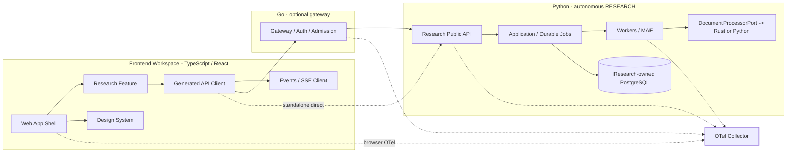

# AGENTIC ECOSYSTEM — FRONTEND & SOURCE ARCHITECTURE v3.2

> **Document ID:** ARC-ECO-005  
> **Date:** 2026-11-13  
> **Status:** Design amendment / implementation status unverified  
> **Applies to:** Polyglot Source Architecture v3.0 + Runtime Architecture v3.1  
> **Decision:** Frontend is a first-class application boundary. The previously completed setup is preserved; no bootstrap/reinitialization is required by this amendment.

## 1. Architectural decision

- **Root:** `agentic-ecosystem/` remains the polyglot modular monorepo, with independently testable/deployable applications.
- **Frontend:** One **Ecosystem Web App** in TypeScript/React; Research is its first domain feature. Future features (Coding, Knowledge, Automation) do not import Research UI internals.
- **Backend:** Go gateway provides edge auth/admission/routing (optional for standalone Research); Python Research API owns Research business state and authorization; Rust provides bounded processing behind a Python port.
- **Contracts:** OpenAPI is the source of truth for frontend/backend HTTP DTOs; generated TypeScript clients are infrastructure, not business rules.
- **State:** TanStack Query (or existing equivalent) for server-derived state; local component state for UI; optional lightweight shared state for cross-page UI only. Do not duplicate run state machine in browser.
- **Delivery:** FE build/test/deploy independent of Research worker/Go gateway. No micro-frontends at v1. No second frontend for Research unless standalone product packaging is needed and justified.
- **Setup:** The project owner confirms previous setup is done. This design DOES NOT claim to have audited their repo, files, installed packages, versions, or commit history. Map the design onto existing names rather than blindly rename/recreate.

## 2. Two independent boundaries



The browser never directly invokes Microsoft Agent Framework, domain ORM, queue, or Rust internals. When direct API mode is used, Python must perform full auth, authorization and browser origin/CSRF protection appropriate to the chosen credential design.

## 3. Target source tree (additive, reconcile with existing setup)

```text
agentic-ecosystem/
├── apps/
│   ├── web/                         # ecosystem frontend; independent entry point
│   │   ├── src/
│   │   │   ├── app/{bootstrap,router,layouts,providers}/
│   │   │   ├── features/
│   │   │   │   └── research/
│   │   │   │       ├── pages/
│   │   │   │       ├── components/
│   │   │   │       ├── api/         # feature-specific query hooks/mappers
│   │   │   │       ├── model/       # presentation types, NOT server source of truth
│   │   │   │       └── routes.ts
│   │   │   ├── shared/{lib,config}/
│   │   │   └── styles/
│   │   ├── tests/
│   │   └── package.json
│   └── gateway-go/                  # Go HTTP/auth/admission (optional)
├── packages/
│   └── frontend/
│       ├── ui/                      # reusable primitives; shared only when needed
│       ├── design-tokens/
│       ├── api-client/              # generated types + transport; no manual DTO drift
│       └── observability/          # browser telemetry wrapper
├── contracts/
│   ├── openapi/research.v1.yaml
│   ├── examples/
│   └── protobuf/                    # optional Rust RPC only when adopted
├── domains/research/
│   ├── apps/{api,worker}/
│   └── src/agentic_research/{public,domain,application,agentic,adapters,bootstrap}/
├── engines/document-rs/
├── deployments/{frontend,gateway,research,observability}/
├── tests/{architecture,e2e,cross-language,load,chaos}/
├── docs/{adr,plans,runbooks}/
├── pnpm-workspace.yaml              # if pnpm is current JS package manager
└── Makefile
```

**Migration note:** If existing setup already uses `apps/research-web`, preserve that working app first. Change only routing, package boundaries or naming when a tested migration reduces coupling; don't churn paths merely to match this diagram. If `packages/frontend` does not yet have at least two consumers, keep shared primitives inside the Web app and extract later.

## 4. Frontend feature boundary and dependency rules

| Boundary | Owns | Must not depend on |
|---|---|---|
| `apps/web/src/app/` | global shell, route registration, provider wiring, auth-facing layouts | Research business logic |
| `features/research` | Research pages, view models, query hooks, UX-specific validation | Other domain feature internals, Python ORM |
| `packages/frontend/ui` | generic components | Research queries, API DTOs |
| `packages/frontend/api-client` | generated request/response schemas, auth transport, errors | React pages and domain workflows |
| `packages/frontend/observability` | sanitized browser telemetry | raw prompt, full source text, tokens/secrets |
| Go Gateway | authenticated edge and admission | Research data writes, Research workflow ownership |
| Python Research | task lifecycle/permissions, artifact access, events | browser state |

Add static dependency rules in CI; API changes must regenerate or validate the TypeScript client. Only `app/bootstrap` wires feature modules and global services together.

## 5. Frontend routing and product scope

| Route | Feature | Contract |
|---|---|---|
| `/research` | Research dashboard | list runs/projects |
| `/research/projects` | projects index | `GET /api/v1/research/projects` |
| `/research/projects/:id` | project workspace | project detail + runs |
| `/research/new` | submit research | `POST /api/v1/research/runs` |
| `/research/runs/:id` | live execution view | status + SSE events |
| `/research/runs/:id/report` | report viewer | result + artifacts |
| `/research/runs/:id/evidence` | evidence inspector | findings + evidence + source locators |
| `/research/history` | history/continuation | list runs + continue |
| `/research/memory` | scoped recall | `POST /api/v1/research/memory/search` |

At R0, implement submit/status/report/sources-evidence first. At R1 add history/continuation, improved explorer and settings. Future domain feature registries are route-level configurations, NOT remote plugin execution.

## 6. API client and runtime contracts

- **Single authoritative contract:** `contracts/openapi/research.v1.yaml`; CI validates the Python API against it and produces a typed TypeScript client. No separate hand-written frontend request schema as a second source of truth.
- **Submit:** `POST /api/v1/research/runs` with `Idempotency-Key`; response `202` plus task/run ID. UI must tolerate repeated form clicks and network retries without duplicate task creation.
- **Observe:** `GET /runs/{id}` and SSE `GET /runs/{id}/events`; persistent `event_id` / last-event replay, reconnect backoff, duplicate-event suppression, polling fallback.
- **Read:** `/result`, `/sources`, `/evidence`, `/findings`, `/artifacts/{id}`; stable artifact identifiers, server authorization, PDF/content views use safe content handling.
- **Errors:** typed `AUTH_REQUIRED`, `FORBIDDEN`, `VALIDATION_FAILED`, `RATE_LIMITED`, `CAPACITY_EXHAUSTED`, `NOT_READY`, `CANCEL_REQUESTED`, `NOT_FOUND`; map to UX states, not exception string matching.
- **Auth:** Prefer existing established deployment auth mode. Cookie-based SSE requires SameSite/CSRF policy and CORS rules; bearer token flows should use a streaming fetch client instead of placing tokens in URLs. Browser checks improve UX but NEVER replace server authorization.

### Client state contract

`ResearchRunView = QUEUED | PLANNING | DISCOVERING | ACQUIRING | ANALYZING | SYNTHESIZING | VERIFYING | COMPLETED | PARTIAL | FAILED | CANCEL_REQUESTED | CANCELLED`.

Browser shows server-emitted status and event timeline, never guesses a transition on its own. `PARTIAL` includes warnings/available artifacts; `FAILED` can still have diagnostic metadata but never implies valid scientific evidence.

## 7. Frontend observability and reliability

- Correlate user action / frontend route / generated `X-Request-ID` with Go/Python backend `traceparent` where supported. `research_run_id` is a structured trace/log attribute, never a metrics label.
- Capture navigation/HTTP duration, error category, SSE reconnect and UI loading failures; minimize telemetry and redact personal research content.
- Trace backend outage cannot break browser core flows; safe fallback to status polling if SSE fails.
- A Research Progress UI should distinguish `backend processing`, `browser disconnected` and `run failed`. Browser disconnect does not cancel background research.
- Load backend and FE separately; track page performance and API enqueue metrics independently. No fabricated Lighthouse or SLO results.

## 8. Independent build, release and test

```text
Frontend CI: format/lint -> typecheck -> component tests -> build -> E2E with mock Research API
Contract CI: OpenAPI lint -> server contract tests -> generated client sync / breaking change check
Domain CI: Python unit/integration/MAF/evidence/recovery tests
Go CI: gateway tests + contract compatibility
Rust CI: parser fixtures + Python parity benchmark
System CI: browser -> gateway/direct -> research task -> SSE/poll -> artifact -> trace
```

**Fitness tests:** UI builds without backend using mocks; backend runs without UI; adding a dummy Coding route doesn't modify Research feature files; same UI can use gateway or direct API via configuration; access to forbidden artifacts is denied server-side; API client remains schema-compatible.

## 9. ADRs to add / preserve

- `ADR-FE-001`: Ecosystem Web App, first feature Research, no microfrontend in R1.
- `ADR-FE-002`: OpenAPI-generated client and transport isolation.
- `ADR-FE-003`: Server-driven task status + SSE replay/poll fallback.
- `ADR-FE-004`: Auth/session mode & browser telemetry redaction.

## 10. Scope control

**Now:** adapt existing workspace, build FE app shell and Research vertical slices, generated client, browser OTel, quality gates.  
**Later:** new domain UI features, standalone per-domain web packaging (only if demand), registry-driven cross-domain navigation.  
**Not now:** microfrontend/module federation, distributed frontend feature marketplace, separate browser workflow engine, backend bypass from frontend.
