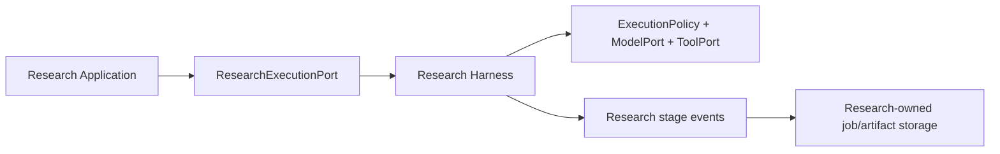

# Core Harness Lite — Incremental Architecture v1

Status: PROPOSED; NOT an implemented framework.
Goal: supply reusable **mechanisms**, without taking over individual domain business logic.

## 1. Why not build an all-in-one Harness first?

At present only Python Research scaffolding exists. A universal state machine, dynamic multi-agent graph, global scheduler or skills marketplace would be speculative. Instead define a very small capability set and exercise it through a real Research use case. Extract a shared implementation only when a second consumer proves compatible semantics.

## 2. Two layers

**Shared Core Harness primitives** (potential packages, not predetermined files):
- Execution identity: run correlation, domain id, task id, authorization context reference.
- ModelPort: structured model invocation, capability metadata, timeout and usage; no implicit provider choice.
- ToolContract: typed request/response, allowlist, timeout, audit event and error class.
- ExecutionPolicy: bounded steps/time/tokens/concurrency/retries and cancellation signal.
- Observability: trace propagation, sanitized events/metrics and stable error taxonomy.
- Optional SkillDescriptor/ToolRegistry only if supported by concrete safe tools.

**Domain-specific Harness / runtime**:
- RESEARCH: stages, research planning, discovery policy, evidence validation, citation and reports.
- SECOND BRAIN: observation, memory consolidation, human approval, supersession and recall policy.
- KB: primarily deterministic ingestion/index/query engines; an LLM is optional for enrichment/answer synthesis.
- Future CODING: separate review/verification/approval and code access policy.

Shared primitives do NOT own ResearchRun state, KB ingestion jobs, SB memory approvals or any domain database.

## 3. Minimal execution slice (after Research domain use cases exist)

One primary Research workflow framework **if** comparative PoC proves value. Existing ADR-0001 mentions MAF as the outbound workflow adapter, but not installed or verified; framework/SDK versions and checkpoint semantics require TECH-01 evidence. Do not add LangGraph and MAF as nested owners of one ResearchRun.

## 4. Durable execution boundaries

- Research API persists run + job atomically before claiming HTTP 202 accepted.
- Research worker leases jobs with attempt limits, lease epochs/fencing and cancellation checks.
- Workflow checkpoint state (framework-specific) is NOT the same as canonical business/job state.
- Different owners for business transaction, job leasing and LLM calls are explicit, but not redundant schedulers.
- Trace context links requests to asynchronous job execution; exporter failure does not fail business work.
- No unbounded loop, execution or provider retries. No unsupported exactly-once claim; prefer at-least-once + idempotency.

## 5. Ports versus framework interfaces

Application owns domain-specific Protocol ports. Concrete SDK adapters live outside domain/application. Do not put raw framework messages, SDK payloads or ORM entities into domain models or public API.

## 6. Shared vs domain-specific extraction rule

Promote to shared only when:
1. At least two real consumers have matching semantics, or a stable cross-domain contract is unavoidable.
2. Boundary and failure contracts are documented.
3. Tests prove consumer independence and version compatibility.
4. Cross-domain auth, observability and performance are understood.

Until then keep use-case-specific code within the domain, even if code looks similar.

## 7. Non-goals for first release

No global orchestrator, marketplace, proprietary Agent Framework reimplementation, shared mutable global prompts, generic graph UI runtime, blanket tool execution or speculative Rust bindings. Multi-domain shared deployment is deferred.

## 8. Engineering acceptance

Codex reviews the smallest designed interfaces and fake-driver tests, flags premature abstractions, requests fault tests. Human implements all application source and approves extraction.
