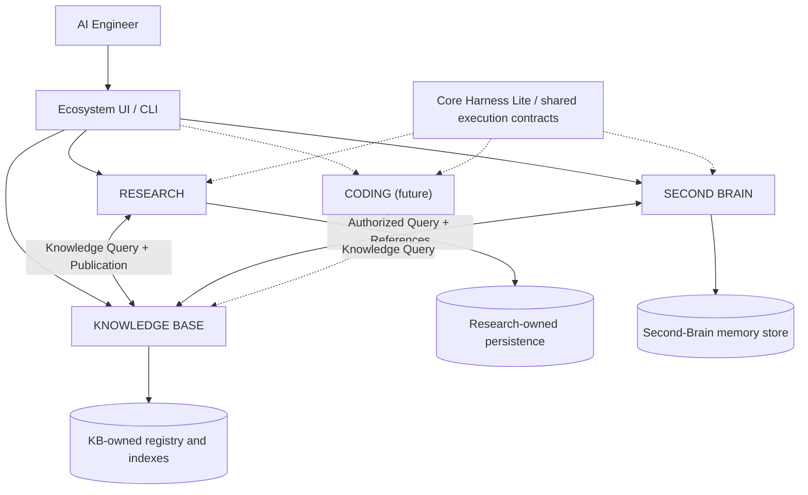

# Ecosystem Context Map v1 — RESEARCH / KB / SECOND BRAIN / Core Harness

Status: PROPOSED — owner review needed (ADR-0005). No domain code is implemented by this design document.
Audience: system designer, solo engineer and Codex reviewer.

## 1. Domain responsibilities and north star

- RESEARCH = evidence-driven engineering investigations. Input: research question, constraints and authorized context. Output: question plan, source manifest, evidence, findings, report, recommendations, experiment plan or ADR draft. Canonical business state: ResearchRun.
- KNOWLEDGE BASE (KB) = reusable knowledge management **and query-serving platform**. Input: authorized publications/documents and query requests. Output: versioned searchable knowledge, knowledge results, scoped ContextBundle or optionally GroundedAnswer. Canonical state: KnowledgeSpace, DocumentVersion and IndexingStatus.
- SECOND BRAIN = memory and continuity of the human engineer. Input: approved observations/decisions/learning milestones, references to research and KB. Output: recalled personal context, memory conflicts, next learning steps, history. Canonical state: MemoryRecord and DecisionMemory.
- CORE HARNESS LITE = shared technical capabilities (execution context, provider/tool ports, guardrails, budgets, tracing), **not a domain owning every Run**.
- Go Gateway and frontend are optional entry/edge interfaces. Each domain enforces its own resource authorization; the Gateway does not substitute for it.

## 2. Context diagram (logical, not deployed services)

Logical domain separation does **not** require a separate process/microservice for every component in MVP. Start with modular boundaries and versioned interfaces; choose deployment topology after usage/operational tests.

## 3. Single owner per fact / aggregate

| Data | Authoritative owner | May consume | Sharing rule |
| --- | --- | --- | --- |
| ResearchRun status, retry and workflow checkpoints | RESEARCH | Research UI, monitoring | Public Research API; never KB/Go writes |
| Source originals/evidence/ResearchReport | RESEARCH | KB, Second Brain (via references) | Publication event + permission and content policy |
| KnowledgeSpace, document versions, chunks, indexes, relations | KB | All authorized domain agents | Scoped Knowledge API, no direct SQL |
| Personal MemoryRecord, goals and personal Decision History | SECOND BRAIN | User; authorized agents via SB interface | Explicit owner control, no implicit global publication |
| Model/tool execution policies and telemetry interfaces | Core Harness Lite | Domain runtimes | Reusable code/contracts; no central business state |
| Authentication identities and memberships | Platform identity boundary (design TBD) | All authorized domains | Trusted signed/validated identity; each domain authorizes |
| Future Coding domain tasks/reviews | CODING | KB/SB by governed references | Own state and versioned publication only |

**Research local context is not Second Brain.** Short-lived run caches and task-specific retrieval inside Research stay Research-owned; they must not evolve into a hidden shared KB clone.

## 4. Three important journeys

### A. Standalone Research

User → Research API → Research Application → durable Research Job/Worker → evidence/source report. KB/SB/Go/Rust/Frontend **not required** for Research core acceptance. If KB cannot be reached, task follows explicit no-external-context or task-fails policy, not a silent fabricated answer.

### B. Cross-domain knowledge publication

Research completes artifact → owner/policy approves publication → Research persists publication intent/outbox → KB registers source ref/version → access checks → ingestion/version/index → status event/receipt. Retry at-least-once; KB idempotency key stops duplicates. Source owner can revoke, which invalidates access at query time and triggers derived artifact/index cleanup.

### C. Personal knowledge continuity

Second Brain fetches the engineer's approved memory (local/private), then optionally requests authorized KB results. It combines but **distinguishes** personal recollection, verified KB evidence, hypothesis and outdated records. Codex/Coding domain may request a scoped ContextBundle but cannot browse arbitrary personal memories.

## 5. API-first boundary

Cross-domain calls use versioned HTTP API, internal RPC or events with stable DTOs; the preferred portable contract is Knowledge API. Agentic Knowledge Tools are outbound adapters wrapping the same API. No tool writes to another domain's DB; no framework-specific objects cross public boundaries.

## 6. Core invariants / failure isolation

1. A domain can be tested without starting the others (using contract fakes) and deploy standalone within its declared functional limits.
2. KB query authorization is enforced before retrieval/rerank/model input **and** when serving document/locator.
3. Knowledge provenance survives transformations; every citation maps to source identity, version and locator.
4. KB/Second Brain downtime cannot corrupt ResearchRun state. Partial context and missing knowledge are explicit.
5. No cyclic synchronous dependency chain (Research→SB→KB→Research). Favor KB as read-serving dependency and asynchronous publication.
6. Shared Harness does not own business transactions/queues for the domains.
7. No Global Orchestrator is built until at least two real domains require a documented multi-domain use case, ADR and recovery design.
8. Tool execution, source fetching and derived knowledge obey permissions, budgets, network restrictions and redaction.

## 7. Decisions deferred and review questions

- Shared identity/auth/session mode: unresolved; confirm before multi-user/staging rollout.
- Whether KB and SB share physical PostgreSQL instance: may share host, **not** schema/roles/repository ownership; prove isolation.
- Frontend: ADR-0002 accepted TypeScript/React; requires superseding ADR to change; no frontend exists yet.
- Knowledge Graph: start with relational node/edge/provenance schema if use case merits; optional GraphRAG strategy after quality benchmark.
- Whether ContextBundle generation can use LLM compression: defer until token/retrieval baseline and injection controls exist.
- Whether shared Harness becomes package/service: defer until second real consumer and tests prove shared invariants.

## 8. Acceptance criteria (architecture-only)

Documented API ownership for each edge, no shared SQL queries, defined outage/degraded behavior, zero cross-domain business logic imports, version/ACL policy, and one independently testable vertical slice for first Research release. PROPOSED until owner accepts ADR-0005.
